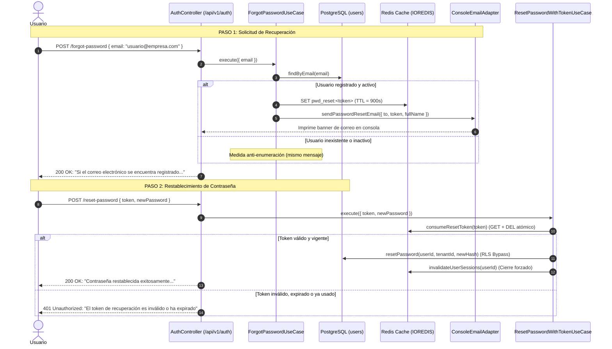

# 🔐 Recuperación de Contraseña Self-Service (Olvido de Contraseña)

Documentación técnica y funcional del mecanismo de autoservicio para la recuperación y restablecimiento de contraseñas de usuarios en el sistema SaaS Contable.

---

## 🎯 1. Contexto y Objetivo

Anteriormente, el sistema únicamente permitía el reseteo administrativo mediante el endpoint `POST /api/v1/users/:id/reset-password` ejecutado exclusivamente por un `OWNER` o un `ADMIN`. Esto obligaba a que cualquier usuario operativo (`ACCOUNTANT`, `WAREHOUSE_MANAGER`, `CASHIER`) tuviera que contactar a un superior para recuperar el acceso a su cuenta.

Con esta implementación, se habilita el flujo estándar de la industria:
1. El usuario solicita la recuperación indicando su correo electrónico.
2. Si el usuario existe y está activo, se genera un token criptográfico temporal con vigencia de 15 minutos en Redis y se simula el envío del correo electrónico.
3. El usuario consume el token a través del endpoint público de restablecimiento para definir su nueva contraseña.
4. Se invalidan todas las sesiones activas en Redis para garantizar que ninguna sesión previa continúe abierta.

---

## 🏛️ 2. Arquitectura Limpia (Hexagonal)

El módulo se diseñó siguiendo los principios de arquitectura limpia y desacoplamiento mediante **Puertos y Adaptadores**:

```text
src/contexts/auth/
├── domain/
│   ├── ports/
│   │   ├── password-reset-token.port.ts   <-- Contrato para persistencia temporal del token
│   │   ├── email-service.port.ts          <-- Contrato para notificación por correo
│   │   ├── password-hasher.port.ts        <-- Cifrado seguro Bcrypt
│   │   └── session-cache.port.ts          <-- Gestión de sesiones en Redis
│   └── exceptions/
│       └── auth.exceptions.ts             <-- Excepciones de dominio (InvalidTokenException, etc.)
├── application/
│   ├── dtos/
│   │   └── auth.dtos.ts                   <-- ForgotPasswordDto, ResetPasswordWithTokenDto
│   └── use-cases/
│       ├── forgot-password.use-case.ts    <-- Lógica de solicitud y anti-enumeración
│       └── reset-password-with-token.use-case.ts <-- Lógica de consumo de token y cambio de clave
└── infrastructure/
    ├── adapters/
    │   ├── redis-password-reset-token.adapter.ts <-- Implementación en Redis con TTL 15 min
    │   ├── console-email.adapter.ts              <-- Simulador de envío de correo en logs
    │   ├── bcrypt-hasher.adapter.ts              <-- Hasheador Bcrypt
    │   └── redis-session.adapter.ts              <-- Invalidador de sesiones
    └── http/
        └── auth.controller.ts             <-- Endpoints públicos expuestos con Rate Limiting
```

---

## 🔄 3. Diagrama de Secuencia



---

## 📡 4. Especificación de Endpoints

### 4.1. Solicitar Recuperación de Contraseña

* **Método:** `POST`
* **Ruta:** `/api/v1/auth/forgot-password`
* **Acceso:** Público (sin Bearer Token).
* **Rate Limiting:** Máximo 3 peticiones por minuto por correo (`RateLimitGuard`).

#### Request Headers
```http
Content-Type: application/json
```

#### Request Body
```json
{
  "email": "admin@techsolutions.com"
}
```

#### Respuestas

* **HTTP 200 OK (Éxito estándar / Anti-enumeración):**
  ```json
  {
    "message": "Si el correo electrónico se encuentra registrado y activo, se ha enviado un enlace para restablecer la contraseña.",
    "devToken": "a28f498c-8591-4cf1-8a9d-b65ec2e53fa6"
  }
  ```
  > [!NOTE]
  > El campo `devToken` se devuelve únicamente cuando `NODE_ENV !== 'production'` para facilitar el desarrollo y pruebas directas en Swagger y Postman sin requerir un cliente SMTP configurado.

* **HTTP 429 Too Many Requests (Exceso de peticiones):**
  ```json
  {
    "statusCode": 429,
    "message": "Demasiadas peticiones. Por favor intente más tarde.",
    "error": "Too Many Requests"
  }
  ```

---

### 4.2. Restablecer Contraseña con Token

* **Método:** `POST`
* **Ruta:** `/api/v1/auth/reset-password`
* **Acceso:** Público (sin Bearer Token).
* **Rate Limiting:** Máximo 5 peticiones por minuto.

#### Request Headers
```http
Content-Type: application/json
```

#### Request Body
```json
{
  "token": "a28f498c-8591-4cf1-8a9d-b65ec2e53fa6",
  "newPassword": "NuevaPasswordSegura123*"
}
```

#### Respuestas

* **HTTP 200 OK (Contraseña actualizada):**
  ```json
  {
    "message": "Contraseña restablecida exitosamente. Ya puede iniciar sesión con su nueva contraseña."
  }
  ```

* **HTTP 401 Unauthorized (Token inválido, expirado o reusado):**
  ```json
  {
    "statusCode": 401,
    "message": "El token de recuperación es inválido o ha expirado",
    "error": "INVALID_TOKEN"
  }
  ```

---

## 🛡️ 5. Mecanismos de Seguridad Implementados

| Mecanismo de Seguridad | Justificación y Detalle Técnico |
|---|---|
| **Anti-Enumeración de Usuarios** | Si un atacante envía correos aleatorios a `/forgot-password`, la respuesta HTTP siempre es `200 OK` con el mismo mensaje, evitando que descubran qué correos pertenecen a empleados de la empresa. |
| **Tokens Criptográficos de Expiración Corta** | Se generan mediante UUIDv4 aleatorios almacenados en Redis bajo la clave `pwd_reset:<token>` con un TTL estricto de **15 minutos (900 segundos)**. |
| **Consumo Único (Anti-Replay Attack)** | El método `consumeResetToken` en Redis realiza la lectura y eliminación inmediata del token (`DEL`). Si alguien intercepta el token e intenta usarlo por segunda vez, la petición es rechazada de inmediato. |
| **Cifrado Fuerte Bcrypt** | La nueva contraseña se encripta con un factor de costo de 10 rondas de salt antes de registrarse en la columna `password_hash` de la tabla `users`. |
| **Invalidación Masiva de Sesiones en Redis** | En cuanto se restablece la contraseña, se eliminan todas las sesiones activas (`session:{userId}:{sessionId}`) del usuario en Redis. Esto desloguea cualquier dispositivo que pudiera estar comprometido. |
| **Compatibilidad con Row-Level Security (RLS)** | Dado que `/reset-password` es un endpoint público (sin token JWT previo), no existen variables de sesión PostgreSQL de RLS (`app.current_tenant_id`). El repositorio [PostgresUserRepository](file:///c:/Users/u/Documents/Utp-TDS/Diplomado/PryContabilidad/Core_architecture_rls_rbac/src/contexts/user/infrastructure/persistence/postgres-user.repository.ts) ejecuta una transacción con `SET LOCAL app.bypass_rls = 'on'` para garantizar que la base de datos permita actualizar el registro sin errores ni filtrados indebidos. |

---

## 💻 6. Guía Rápida de Pruebas para Desarrolladores y Frontend

### Opción A: Usando la Colección de Postman
1. Abre Postman e importa el archivo [`mock/postman-collection.json`](file:///c:/Users/u/Documents/Utp-TDS/Diplomado/PryContabilidad/Core_architecture_rls_rbac/mock/postman-collection.json).
2. Ve a la carpeta **Auth**:
   * Ejecuta: `POST /auth/forgot-password - Solicitar Recuperacion` enviando el correo de prueba (ej: `admin@techsolutions.com`).
   * En la respuesta copia el valor del campo `devToken`.
   * Ejecuta: `POST /auth/reset-password - Restablecer con Token` pegando el token en el campo `token` y definiendo una nueva contraseña.
3. Intenta iniciar sesión con `POST /api/v1/auth/login` usando la nueva contraseña.

### Opción B: Usando cURL

```bash
# 1. Solicitar recuperación
curl -X POST http://localhost:3001/api/v1/auth/forgot-password \
  -H "Content-Type: application/json" \
  -d '{"email": "admin@techsolutions.com"}'

# 2. Restablecer contraseña con el token recibido
curl -X POST http://localhost:3001/api/v1/auth/reset-password \
  -H "Content-Type: application/json" \
  -d '{
    "token": "PEGA_AQUI_EL_DEV_TOKEN",
    "newPassword": "NuevaPassword123*"
  }'

# 3. Validar nuevo login
curl -X POST http://localhost:3001/api/v1/auth/login \
  -H "Content-Type: application/json" \
  -d '{
    "email": "admin@techsolutions.com",
    "password": "NuevaPassword123*"
  }'
```

### Opción C: Ver el Correo en la Consola
Al ejecutar la solicitud, en la terminal de Node.js donde corre el backend verás un log formateado como el siguiente:

```text
[EmailService] 
============================================================
📧 [EMAIL SIMULATOR] RECUPERACIÓN DE CONTRASEÑA
Destinatario : Admin User <admin@techsolutions.com>
Token (15 min): c6f37628-98e8-466d-8b01-9dc55d6480b5
Acción      : Enviar POST a /api/v1/auth/reset-password con:
{
  "token": "c6f37628-98e8-466d-8b01-9dc55d6480b5",
  "newPassword": "TuNuevaPassword123*"
}
============================================================
```
