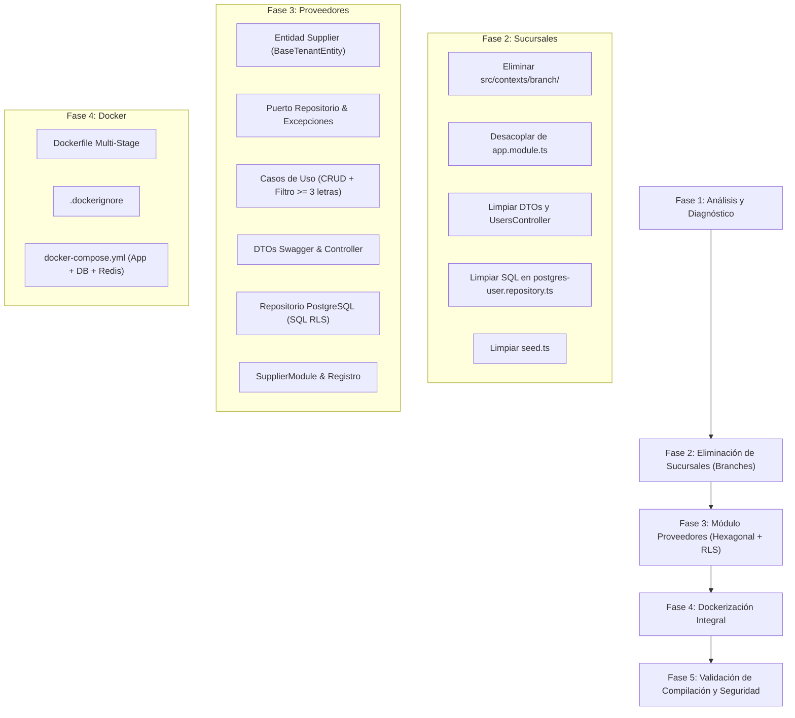

# 📋 Plan de Trabajo y Estado de Ejecución del Proyecto
**Proyecto:** Core Architecture — Multi-Tenancy, RLS & RBAC  
**Perfil:** Estudiante de Desarrollo de Software (7mo Semestre)  
**Fecha:** Noviembre 2026  
**Enfoque:** Arquitectura Hexagonal, SOLID, PostgreSQL RLS, RBAC, Redis, Docker

---

## 1. Diagnóstico Arquitectónico y Requerimientos

El sistema está estructurado bajo **Arquitectura Hexagonal (Ports & Adapters)** y patrones avanzados de seguridad:
* **Aislamiento Multi-Tenant:** Implementado a nivel de base de datos con **PostgreSQL Row-Level Security (RLS)** mediante variables de sesión transaccionales (`app.current_tenant_id`, `app.current_user_id`, `app.current_role`).
* **Seguridad y Control de Acceso (RBAC):** Guardias (`JwtAuthGuard`, `RolesGuard`) y decoradores (`@Roles`) para 5 roles (`OWNER`, `ADMIN`, `ACCOUNTANT`, `WAREHOUSE_MANAGER`, `CASHIER`).
* **Caché y Sesiones:** Redis para invalidación reactiva de tokens, sesiones y caché de entidades tenant.
* **Auditoría:** Trazabilidad de operaciones críticas en la tabla `audit_logs`.
* **Regla de Estilo Estricta:** Código libre de comentarios (`//` y `/* */`) y respeto total de la jerarquía de directorios existente (`src/contexts/` y `src/shared/`).

---

## 2. Diagrama de Flujo del Roadmap

---

## 3. Matriz de Estado de Tareas

### Leyenda de Estados
* ✅ **Completado:** Tarea implementada y verificada.
* 🔄 **En Progreso:** Tarea con avances parciales en el código.
* ⏳ **Pendiente:** Tarea planificada lista para ejecución.

| ID | Módulo / Fase | Tarea Específica | Estado | Detalles Técnicos |
| :---: | :--- | :--- | :---: | :--- |
| **1.1** | **Diagnóstico** | Análisis de dependencias, RLS, RBAC y Redis | ✅ | Mapeo de puertos, adaptadores y reglas SOLID del proyecto. |
| **2.1** | **Sucursales** | Eliminación física de `src/contexts/branch/` | ✅ | Se eliminaron entidades, puertos, casos de uso, DTOs, controlador y repositorio de branches. |
| **2.2** | **Sucursales** | Desacoplamiento de `BranchModule` en `src/app.module.ts` | ✅ | Retirada la importación y remoción del arreglo `imports`. |
| **2.3** | **Sucursales** | Desacoplamiento en `src/contexts/user/infrastructure/user.module.ts` | ✅ | Eliminada la inyección de `BranchModule`. |
| **2.4** | **Sucursales** | Limpieza de `users.controller.ts` y `user.dtos.ts` | ✅ | Removido `GetBranchUseCase`, campo `branchName` y asignación física de sedes. |
| **2.5** | **Sucursales** | Ajuste en `user.use-cases.ts` y excepciones | ✅ | Eliminadas validaciones obligatorias de sucursal para cajeros/bodegueros. |
| **2.6** | **Sucursales** | Limpieza en `postgres-user.repository.ts` | ✅ | Retirado `LEFT JOIN branches`, `branch_id` y `branch_name` de todas las consultas nativas. |
| **2.7** | **Sucursales** | Actualización de script de inicialización (`seed.ts`) | ✅ | Eliminada inserción de branches, políticas RLS de branches y `branch_id` de usuarios. |
| **3.1** | **Proveedores** | Entidad de Dominio (`supplier.entity.ts`) | ✅ | Extensión de `BaseTenantEntity` para heredar `tenantId`, fechas y métodos de dominio. |
| **3.2** | **Proveedores** | Puerto del Repositorio (`supplier-repository.port.ts`) | ✅ | Métodos CRUD, soft-delete, paginación tipada y símbolo de inyección. |
| **3.3** | **Proveedores** | Excepciones de Dominio (`supplier.exceptions.ts`) | ✅ | `SupplierNotFoundException`, `SupplierAlreadyExistsException`, `SupplierFilterTooShortException`. |
| **3.4** | **Proveedores** | Casos de Uso (`supplier.use-cases.ts`) | ✅ | Lógica de negocio: validación de filtro ≥ 3 chars, unicidad NIT/RUT por tenant, paginación. |
| **3.5** | **Proveedores** | DTOs HTTP (`supplier.dtos.ts`) | ✅ | Validaciones con `class-validator`, transformaciones, `@Type` y Swagger. |
| **3.6** | **Proveedores** | Controlador REST (`suppliers.controller.ts`) | ✅ | Endpoints `/api/v1/suppliers` blindados con `@UseGuards(JwtAuthGuard, RolesGuard)` y RBAC. |
| **3.7** | **Proveedores** | Repositorio PostgreSQL (`postgres-supplier.repository.ts`) | ✅ | Consultas nativas con `this.queryFn`, búsqueda `ILIKE`, paginación y RLS. |
| **3.8** | **Proveedores** | Registro de Módulo (`supplier.module.ts` & `app.module.ts`) | ✅ | Enlace de puertos con adaptadores y exportación limpia para inyección de dependencias. |
| **4.1** | **Docker** | Definición de `Dockerfile` multi-stage | ⏳ | Etapas de dependencias, compilación TypeScript (`dist`) y runtime optimizado con Alpine. |
| **4.2** | **Docker** | Creación de `.dockerignore` | ⏳ | Ignorar `node_modules`, `dist`, `.env`, scripts locales y logs. |
| **4.3** | **Docker** | Orquestación en `docker-compose.yml` | ⏳ | Adición del servicio `api` interconectado a `postgres` y `redis` bajo la red `core_network`. |
| **5.1** | **Validación** | Cero comentarios en código | ⏳ | Revisión de todos los archivos modificados y nuevos para cumplir la regla estricta. |
| **5.2** | **Validación** | Compilación y comprobación de tipos | ⏳ | Ejecución de `npm run build` para garantizar cero errores de TypeScript y empaquetado ESM. |

---

## 4. Estrategia de Seguridad para Proveedores (Multi-Tenancy Personal)

Para cumplir con el requerimiento de que los proveedores pertenezcan exclusivamente a la empresa del usuario y no sean compartidos:

1. **Aislamiento por Tenant (RLS):** Cada registro en la tabla `suppliers` almacenará el `tenant_id` obtenido directamente del token JWT verificado (`req.user.tenantId`). Ningún usuario podrá enviar o forzar un `tenantId` de otra entidad.
2. **Consultas Seguras con Contexto:** El repositorio ejecutará las consultas a través de `this.queryFn`, que opera dentro del contexto de transacción con RLS activo configurado por `RlsInterceptor`.
3. **Filtro de Búsqueda:** La búsqueda textual se realizará con `ILIKE %filtro%` condicionado a un largo mínimo estricto de 3 caracteres tanto en el DTO (`@MinLength(3)`) como en la regla de negocio del caso de uso.
4. **Permisos RBAC:**
   * **Lectura (`GET`):** Roles `OWNER`, `ADMIN`, `ACCOUNTANT`.
   * **Escritura / Modificación (`POST`, `PATCH`, `DELETE`):** Roles directivos `OWNER` y `ADMIN`.
